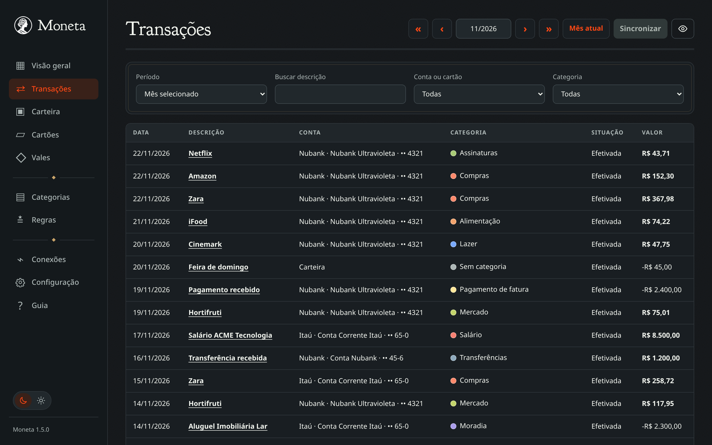
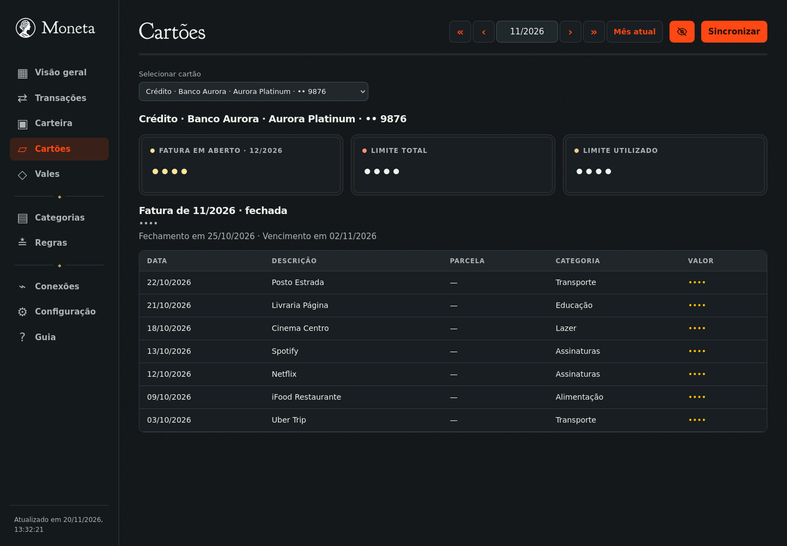
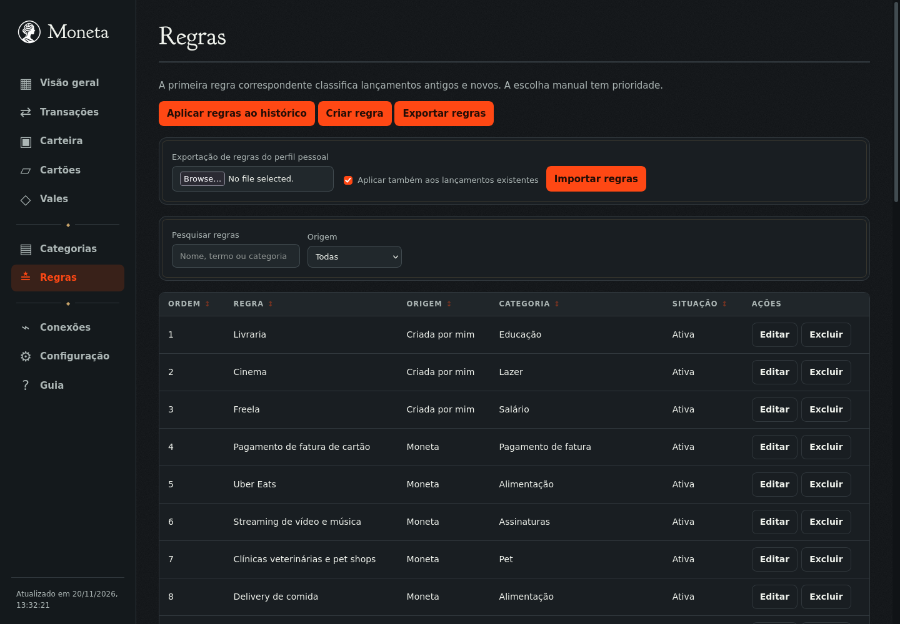

<p align="center">
  
</p>

<h1 align="center">Moneta</h1>

Moneta é um painel de finanças pessoais que roda no seu próprio computador. Ele se conecta aos seus bancos, cartões e corretoras por meio da [Pluggy](https://pluggy.ai), uma plataforma de Open Finance, e guarda tudo em um banco SQLite local. Assim você acompanha receitas, despesas, faturas e patrimônio sem enviar seus dados a um serviço de terceiros além da própria Pluggy.

- **Local e de usuário único:** o servidor escuta apenas em `127.0.0.1` e não tem contas de usuário.
- **Sem dependências externas:** usa só Node.js 22 (servidor HTTP e `node:sqlite` nativos) e HTML, CSS e JavaScript puros no navegador.
- **Interface em português**, com valores em várias moedas mantidos separados.

> **Primeira vez?** O [Guia de conexão](docs/guia/conectar-bancos.md) mostra, passo a passo e com imagens, como criar as contas gratuitas na Pluggy, pegar o Client ID e o Client Secret e conectar seus bancos. Não é preciso saber programar. O mesmo guia abre dentro do Moneta, no menu **Guia**.

## Capturas de tela

As imagens usam uma base de demonstração com dados fictícios e o modo que oculta os valores.


| | |
| --- | --- |
|  |  |
|  |  |
|  |  |

## Requisitos

- Para o app instalado: Linux x86_64 ou Windows 10/11 de 64 bits, e um navegador. O instalador já traz tudo o que o Moneta precisa.
- Para rodar pelo código: Docker com Docker Compose **ou** Node.js 22.16 ou superior.
- Uma aplicação na Pluggy, com **Client ID** e **Client Secret**. Para uso pessoal ela é gratuita; o [Guia de conexão](docs/guia/conectar-bancos.md) mostra como criar.
- Acesso à internet para a API e o widget de conexão da Pluggy.

## Instalação

### Linux

No terminal:

```sh
curl -fsSL https://github.com/feittosaa/moneta/releases/latest/download/install.sh | sh
```

O comando baixa a versão mais recente, confere o arquivo, instala o app em `~/.local/lib/moneta` e cria o atalho **Moneta** no menu de aplicativos, sem pedir senha de administrador. Depois, abra pelo menu ou rode `moneta`.

Para que o Moneta ligue sozinho, em segundo plano, sempre que você entrar no computador (na porta 4173, sem abrir o navegador):

```sh
curl -fsSL https://github.com/feittosaa/moneta/releases/latest/download/install.sh | sh -s -- --iniciar-com-o-sistema
```

Isso cria um serviço de usuário do systemd, em sandbox: o Moneta só consegue escrever na própria pasta de dados. Para desligar o início automático, rode `systemctl --user disable --now moneta`.

Prefere não usar o terminal? Baixe o [Moneta-x86_64.AppImage](https://github.com/feittosaa/moneta/releases/latest/download/Moneta-x86_64.AppImage), marque como executável (nas propriedades do arquivo, **Permitir executar como programa**) e abra com dois cliques.

Para remover, mantendo os seus dados:

```sh
curl -fsSL https://github.com/feittosaa/moneta/releases/latest/download/install.sh | sh -s -- --remover
```

### Windows

Baixe e abra o [Moneta-Setup.exe](https://github.com/feittosaa/moneta/releases/latest/download/Moneta-Setup.exe). Ele instala só para o seu usuário, sem pedir administrador, e cria atalhos no menu Iniciar e na área de trabalho. Na instalação, a opção **Iniciar com o Windows, em segundo plano** deixa o Moneta ligado na bandeja desde o login. O Moneta usa o Microsoft Edge WebView2, que já vem no Windows 11 e no Windows 10 atualizado. Para remover, use **Configurações → Aplicativos**.

O instalador não tem assinatura digital paga, por isso o Windows pode mostrar "O Windows protegeu o computador". Clique em **Mais informações** e depois em **Executar assim mesmo**.

### Como o app instalado funciona

- **Linux:** pelo menu, pela barra de tarefas ou com `moneta`, o painel abre numa janela própria. Ela usa o servidor que já estiver ligado (o serviço do systemd, por exemplo) ou sobe um, e fechar a janela não desliga o serviço. A janela usa o WebKitGTK 4.1 do sistema (`webkit2gtk4.1` no Fedora, `libwebkit2gtk-4.1-0` no Debian e no Ubuntu); sem ele, o Moneta abre no navegador.
- **Windows:** o Moneta abre numa janela própria, sem terminal. Fechar a janela deixa o Moneta na bandeja, sincronizando. Para voltar, clique no ícone da bandeja ou abra pelo menu Iniciar. A janela é feita com [Tauri](https://tauri.app) e fica em `desktop/`.
- Para encerrar em qualquer sistema, use **Configuração → Encerrar o Moneta** ou, no Windows, **Encerrar o Moneta** no ícone da bandeja. Com o início automático do Linux, ele volta a ligar no próximo login, ou na hora com `systemctl --user start moneta`.
- Quem já usava o Moneta pelo Docker pode levar os dados: pare o container (`docker compose down`) e copie o conteúdo de `data/` para a pasta de dados do app instalado. Na primeira abertura, as chaves que estavam em arquivo comum são lacradas pelo sistema.
- Os dados ficam em `~/.local/share/moneta` no Linux e em `%LOCALAPPDATA%\Moneta` no Windows. Atualizar ou remover o app não apaga os dados.
- Para atualizar, rode o comando de instalação de novo ou baixe e abra o instalador mais recente.

Todas as versões, com as somas de verificação, ficam em [Releases](https://github.com/feittosaa/moneta/releases).

### Com Docker Compose

Na raiz do projeto:

```sh
mkdir -p -m 700 data
docker compose up -d --build
```

Abra http://127.0.0.1:4173. Para parar, use `docker compose down`.

A pasta `./data` é montada no container e guarda o banco e as credenciais, por isso os dados sobrevivem a recriações do container. O serviço roda com UID/GID 1000. Se o seu usuário no Linux tiver outros IDs, crie um arquivo `.env` com os valores de `id -u` e `id -g`:

```sh
MONETA_UID=1001
MONETA_GID=1001
```

### Com Node.js

```sh
node --env-file-if-exists=.env server.mjs
```

Abra http://127.0.0.1:4173. Não é preciso instalar pacotes: o projeto não tem dependências npm.

Encerre uma das formas de execução antes de iniciar a outra, pois ambas usam a mesma porta.

### Variáveis de ambiente

Todas são opcionais.

| Variável | Padrão | Uso |
| --- | --- | --- |
| `PORT` | `4173` | Porta do servidor. |
| `MONETA_SECRET_STORE` | automático | Use `arquivo` para guardar as credenciais em JSON `0600` em vez de lacrá-las pelo sistema. |
| `MONETA_DATA_DIR` | `./data` | Pasta do banco e das credenciais. O app instalado usa a pasta de dados do usuário. |
| `PLUGGY_CLIENT_ID` e `PLUGGY_CLIENT_SECRET` | vazio | Credenciais da Pluggy. Valem até que outro par seja salvo pela interface. |
| `MONETA_UID` e `MONETA_GID` | `1000` | Usuário e grupo do container (somente Docker). |

## Primeiros passos

O [Guia de conexão](docs/guia/conectar-bancos.md) detalha cada passo abaixo, inclusive a criação das contas na Pluggy e no Meu Pluggy. Em resumo:

1. Em **Configuração**, informe o Client ID e o Client Secret e clique em **Validar e salvar**. As credenciais passam a valer assim que a Pluggy as aceita.
2. Em **Conexões**, clique em **Conectar instituição**, escolha **MeuPluggy** no widget da Pluggy e autorize o acesso aos bancos que você conectou no Meu Pluggy.
3. A Moneta sincroniza a nova conexão logo em seguida. Depois disso, use **Sincronizar** quando quiser atualizar. Com o servidor ligado, uma sincronização automática ocorre a cada 6 horas.

A sincronização lê todo o histórico disponível na Pluggy e só grava o resultado depois de ler todas as conexões. Se algo falhar no meio do caminho, a cópia anterior é mantida.

## Telas

### Visão geral

- **Resumo mensal:** receitas, despesas, resultado e despesas por categoria do mês escolhido. Débitos e créditos em conta contam na data do lançamento. Compras no cartão contam pelo total da fatura no mês do vencimento, inclusive parcelas. Quando a instituição não informa a fatura, a Moneta a reconstrói a partir dos pagamentos identificados e avisa que a cobertura pode estar incompleta. Em **Despesas por categoria**, as faturas aparecem agrupadas em uma linha só, **Faturas de cartão**. Escolha **Somente faturas** para ver a composição delas por categoria.
- **Patrimônio:** posição da última sincronização e sua evolução diária. O **bruto** soma saldos positivos e investimentos brutos. O **líquido** usa investimentos líquidos e desconta dívidas de cartão e saldos negativos. O valor aplicado automaticamente pelo banco é descontado do saldo da conta para não ser contado duas vezes. Valores que a instituição não informou aparecem como indisponíveis.

### Transações

Lista os lançamentos de todas as contas. Você pode:

- escolher o **Período**: o mês selecionado no topo da página ou **Todos os meses**, para ver o histórico inteiro na moeda selecionada;
- buscar pela descrição e filtrar por conta, cartão ou categoria;
- clicar em uma transação para mudar a categoria, escrever uma nota ou criar uma regra a partir dela. Escolha **Automática** para devolver a transação às regras.

Valores positivos aparecem em negrito.

### Carteira

Registra dinheiro em espécie, que não passa pela Pluggy. **Adicionar saldo** e **Retirar saldo** só ajustam o saldo da carteira. **Receita em dinheiro** e **Despesa em dinheiro** também entram no resultado do mês.

Ao lado do saldo em dinheiro, **Saldo nos bancos** soma as contas bancárias na moeda selecionada, como as instituições informaram na última sincronização. As três maiores aparecem logo abaixo do total. Passe o mouse sobre o cartão, ou selecione-o pelo teclado, para ver todas as contas.

### Cartões

Mostra cada cartão de crédito com as compras do ciclo (inclusive parcelas), a situação da fatura (fechada, em aberto ou estimada), o limite total e o limite utilizado. Faturas fechadas continuam disponíveis mesmo depois que saem da janela de histórico da Pluggy.

### Vales

Vale-transporte, vale-alimentação e outros benefícios não chegam pela Pluggy. Na página **Vales**, clique em **Adicionar vale** e informe o nome, o valor de cada crédito, a categoria do gasto e a recorrência:

- **Mensal:** todo mês no dia do primeiro crédito. Nos meses sem esse dia (31, por exemplo), cai no último dia do mês;
- **Semanal:** toda semana no mesmo dia da semana do primeiro crédito;
- **Diária:** todos os dias, ou só de segunda a sexta com **Só dias úteis**, como num vale-transporte;
- **Uso único:** um crédito só, como um bônus.

Cada crédito, até a data de hoje, entra no mês como receita na categoria **Benefícios** e, na mesma data, como despesa na categoria do vale. O total de despesas passa a incluir o que foi pago com vale, com um item próprio, **Vales**, e o resultado do mês não muda. A página mostra o total creditado no mês, os vales cadastrados e cada crédito do mês selecionado.

Para parar um vale recorrente sem perder o histórico, edite-o e informe o **Último crédito**. Editar o valor ou a recorrência recalcula todos os créditos do vale. Para mudar só daqui em diante, encerre o vale atual e crie outro. **Excluir** remove o vale e todos os créditos já lançados por ele.

### Categorias

Crie, renomeie, recolora ou remova categorias. Uma categoria marcada como **interna** fica fora do fluxo mensal. Use esse tipo para movimentos que não são receita nem despesa, como pagamentos de fatura e aplicações e resgates de investimentos.

Filtre a lista pela **Origem**: categorias criadas por você (inclusive as criadas ao importar regras) ou que já vêm com a Moneta.

### Regras

Regras classificam lançamentos automaticamente. Cada regra combina condições sobre a descrição, o valor, a data, o tipo, a situação ou o CPF/CNPJ do destinatário. As condições podem exigir que todas coincidam ou que qualquer uma coincida. Os operadores disponíveis são: contém, não contém, começa com, termina com, igual, diferente, expressão regular e comparações numéricas (maior, menor, maior ou igual, menor ou igual).

Filtre a lista pela **Origem**. Regras criadas na Moneta e regras importadas contam como suas; as do catálogo padrão aparecem como **Moneta**.

**Aplicar regras ao histórico** reavalia todos os lançamentos com as regras ativas, preservando as escolhas manuais. Antes de aplicar, a Moneta mostra uma prévia com cada lançamento que muda de categoria, a categoria atual e a nova. Nada muda até você confirmar. Se os dados mudarem entre a prévia e a confirmação (por uma sincronização, por exemplo), a aplicação é recusada e você revisa a prévia de novo.

Nas tabelas de regras e de categorias, clique no título de uma coluna para ordenar. O primeiro clique ordena de forma crescente, o segundo de forma decrescente e o terceiro volta à ordem padrão. A seta ao lado do título mostra a ordenação ativa.

### Configuração

Define a moeda padrão, o tema (igual ao sistema, que é o padrão, escuro ou claro, guardado neste navegador), as credenciais da Pluggy e permite reiniciar o servidor (funciona tanto no Docker quanto na execução direta).

### Guia

Abaixo de Configuração, o **Guia** mostra o [Guia de conexão](docs/guia/conectar-bancos.md) dentro do app. O texto e as imagens ficam em `docs/guia/` e são os mesmos que aparecem no GitHub.

### Barra superior

Nas páginas que dependem do mês (Visão geral, Transações, Carteira, Cartões e Vales), a barra superior tem os mesmos controles e no mesmo lugar: ano e mês anterior, o seletor de mês, mês e ano seguinte e **Mês atual**, que volta ao mês corrente. O botão com o ícone de olho oculta os valores da tela.

Datas aparecem e são digitadas no padrão dia, mês e ano (`dd/mm/aaaa`), e o seletor de mês usa `mm/aaaa`, qualquer que seja o idioma do navegador. Basta digitar os números, que as barras entram sozinhas. O botão com o ícone de calendário abre o calendário do navegador.

## Como uma transação é classificada

A Moneta usa a primeira fonte disponível, nesta ordem:

1. a categoria escolhida manualmente na transação;
2. as regras criadas na Moneta;
3. as regras do catálogo, em ordem crescente de prioridade (com a mesma prioridade, as regras importadas vêm antes das padrão);
4. a categoria informada pela Pluggy.

Pagamentos de fatura e aplicações e resgates de investimentos são reconhecidos pela descrição e vão para as categorias internas **Pagamento de fatura** e **Movimentação de investimentos**, para não inflarem receitas e despesas. Rendimentos e impostos sobre investimentos continuam contando como receita e despesa.

## Catálogo de regras

O arquivo [`default-rules.json`](default-rules.json) traz regras prontas para comércios e serviços comuns no Brasil, como delivery, mercados, transporte, assinaturas, farmácias e contas da casa, além de pagamentos de fatura, aplicações, salário e rendimentos. Elas aparecem com a origem **Moneta** na tela de regras, podem ser editadas ou desativadas e vêm todas ativas.

Para compartilhar regras com alguém ou levá-las para outra instalação, clique em **Exportar regras**. A Moneta baixa um arquivo JSON (`moneta-categorization-rules`, versão 1) com as regras da origem escolhida no filtro: todas, só as suas ou só as do catálogo, já com as suas edições. As regras criadas na Moneta saem com prioridade menor que a do catálogo, para continuarem vencendo depois de importadas.

Para importar um arquivo nesse formato, vá em **Regras**, selecione o arquivo e clique em **Importar regras**:

- regras com o mesmo nome são atualizadas, por isso importar de novo traz as alterações do arquivo;
- categorias que ainda não existem são criadas;
- a tela sinaliza regras sem uma categoria de destino ou que usam campos que a Moneta ainda não lê;
- com **Aplicar também aos lançamentos existentes** marcado, todo o histórico é reavaliado. Desmarcado, a classificação atual é preservada e as regras importadas valem apenas para lançamentos novos.

## Dados e privacidade

Tudo fica na pasta de dados: `data/` no Docker e no Node.js (ela está no `.gitignore`), `~/.local/share/moneta` no app instalado no Linux e `%LOCALAPPDATA%\Moneta` no Windows:

- `moneta.cofre`: o banco inteiro (conexões, saldos, investimentos, lançamentos, faturas, vales, categorias, regras, notas e histórico de patrimônio), cifrado com AES-256-GCM. Enquanto o Moneta roda, o banco fica só na memória. `moneta.cofre.anterior` é a gravação anterior, usada se a última for interrompida;
- `banco.cred` (Linux) ou `banco.dpapi` (Windows): a chave do cofre, lacrada pelo sistema. Sem esse recurso, como no Docker, fica em `banco.key` com permissão `0600`, ao lado do cofre;
- `pluggy.cred` (Linux) ou `pluggy.dpapi` (Windows): credenciais da Pluggy lacradas pelo sistema. Sem esse recurso, como no Docker, ficam em `pluggy.json` com permissão `0600`;
- `banco-senha.cred` no lugar de `banco.cred`, com o **modo cofre** ligado: a chave do cofre cifrada com a sua senha e, por cima, lacrada pelo sistema;
- `backups/`: um backup automático por dia, dos últimos 7 dias, cifrado e testado depois de criado. Em **Configuração → Backups** dá para baixar um backup para guardar fora do computador e restaurar de um arquivo;
- `acesso.key`: chave que libera o navegador, trocada por um cookie quando você abre o Moneta pelo atalho.

Com o **modo cofre** (em Configuração), o Moneta pede uma senha para abrir e tranca sozinho depois de um tempo sem uso. Trancado, nem um programa rodando com o seu usuário consegue abrir o banco; em troca, a sincronização automática só acontece com ele aberto.

A API só responde a navegadores autorizados pela chave de acesso. O servidor também recusa cabeçalhos `Host` diferentes de `localhost` e `127.0.0.1` e escritas vindas de outra origem, e envia uma política de segurança de conteúdo restrita. Os únicos dados que saem da máquina são as chamadas à API da Pluggy. O documento [Segurança](docs/seguranca.md) detalha o modelo de ameaças, as proteções e os riscos que ainda ficam.

Outros programas locais podem ler os dados pela API, enviando `Authorization: Bearer` com o conteúdo de `acesso.key`. O contrato está em [Integração](docs/integracao.md).

## Desenvolvimento

Rode os testes com o executor nativo do Node.js:

```sh
node --test
```

Para gerar os instaladores localmente (precisa de `curl`, `xz`, `unzip`, `makensis` e `sha256sum`):

```sh
packaging/build.sh 1.0.0
```

Os arquivos saem em `dist/`. Ao enviar uma tag de versão, como `1.0.0`, o GitHub Actions roda os testes, gera os instaladores e publica a release.

Estrutura do projeto:

| Caminho | Conteúdo |
| --- | --- |
| `server.mjs` | Processo supervisor que inicia e reinicia o backend; com `--desktop`, usa a pasta de dados do usuário e abre o navegador. |
| `backend.mjs` | Servidor HTTP, rotas da API e integração com a Pluggy. |
| `finance.mjs` | Banco SQLite, sincronização e classificação de lançamentos. |
| `category-rules.mjs` | Catálogo de regras, importação e avaliação de condições. |
| `default-rules.json` | Regras padrão do catálogo. |
| `request-body.mjs` | Leitura e validação do corpo JSON das requisições. |
| `vault.mjs` | Cofre do banco: SQLite em memória, gravado cifrado com AES-256-GCM em `moneta.cofre`, migração verificada e chave de recuperação. |
| `secret-store.mjs` | Lacre das credenciais da Pluggy pelo sistema (systemd-creds no Linux, DPAPI no Windows). |
| `public/` | Interface: HTML, CSS e módulos JavaScript (relatório, ciclos de cartão, patrimônio, campos de data), ícones e fontes. |
| `packaging/` | Scripts que geram o AppImage, o instalador do Windows e o comando de instalação para Linux. |
| `.github/workflows/` | Publicação automática da release ao enviar uma tag de versão. |
| `docs/guia/` | Guia de conexão (Markdown e imagens), exibido no app e no GitHub. |
| `desktop/` | Janela nativa (Tauri, Rust): sobe o servidor escondido, abre o painel autorizado e fica na bandeja. |
| `docs/integracao.md` | Contrato para programas locais, como a Ayla: como encontrar o Moneta, autenticar e ler os dados. |
| `docs/seguranca.md` | Modelo de ameaças, proteções, riscos aceitos e próximos passos de segurança. |
| `test/` | Testes automatizados. |

### Fontes

O nome Moneta e os títulos das páginas usam a [Goudy Bookletter 1911](https://github.com/theleagueof/goudy-bookletter-1911), de Barry Schwartz, distribuída em `public/fonts/` sob a SIL Open Font License 1.1 (veja [`public/fonts/OFL.txt`](public/fonts/OFL.txt)). O restante da interface usa a fonte sem serifa do sistema. O projeto só usa fontes gratuitas.

## Licença

O código é distribuído sob a [licença MIT](LICENSE): qualquer pessoa pode usar, copiar, modificar e redistribuir, inclusive em outros projetos, desde que mantenha o aviso de copyright. A fonte Goudy Bookletter 1911 segue a sua própria licença, a SIL Open Font License 1.1.
