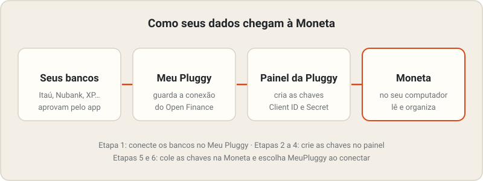
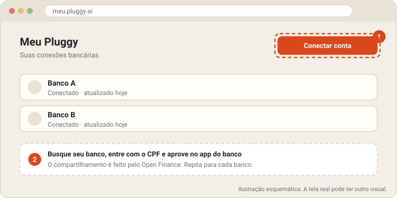
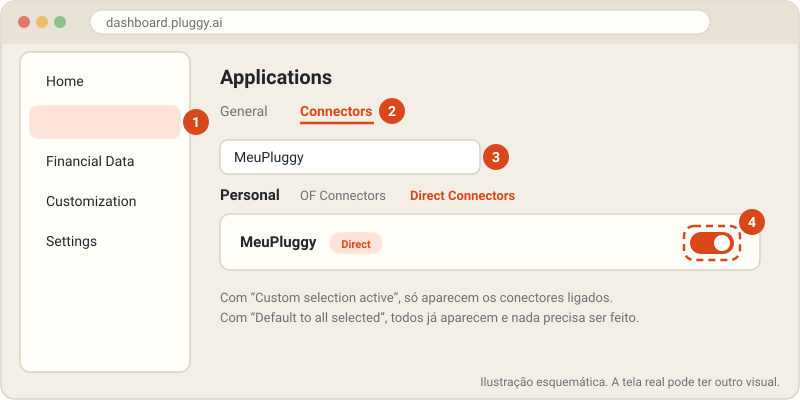
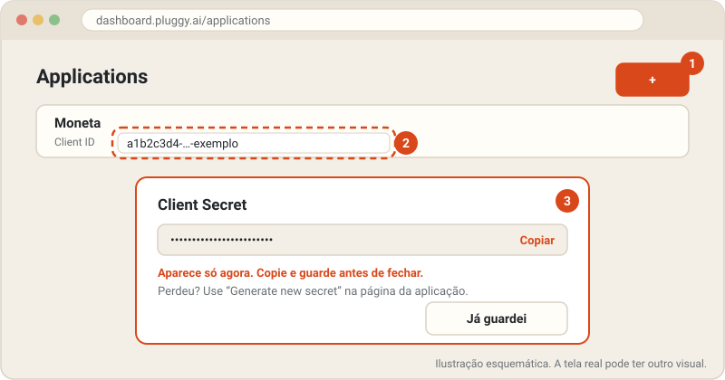
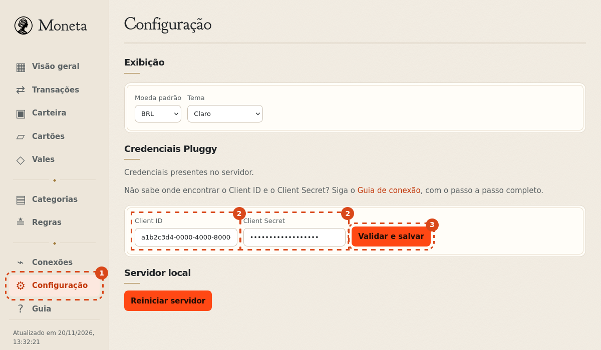
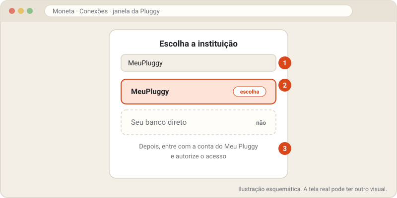
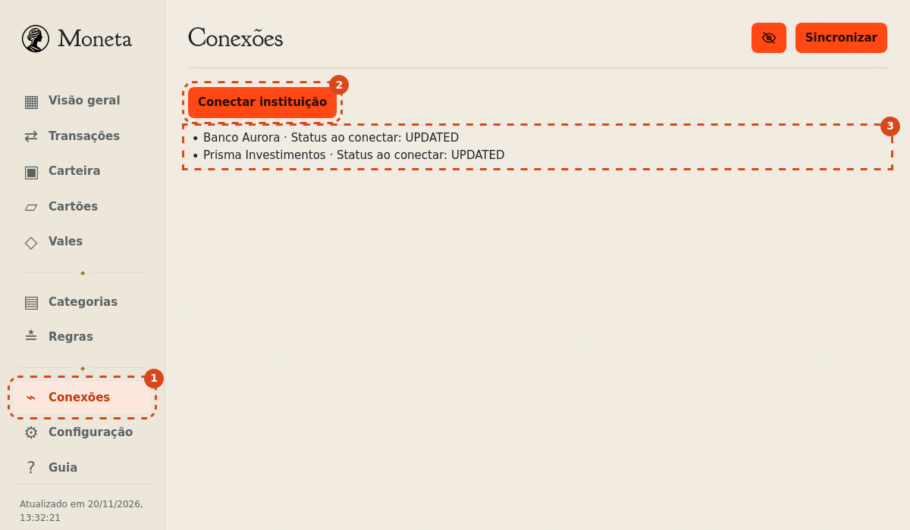

# Guia de conexão: seus bancos no Moneta

Este guia leva você do zero até ver suas contas no Moneta, sem precisar saber programar. Reserve uns 15 minutos e siga as etapas na ordem.

O Moneta não entra no seu banco. Quem faz essa ponte é a **Pluggy**, uma empresa de Open Finance, o sistema oficial do Banco Central para compartilhar dados bancários com a sua autorização. O caminho tem três partes:

1. **Meu Pluggy**: onde você conecta seus bancos.
2. **Painel da Pluggy**: onde você cria duas chaves de acesso, o **Client ID** e o **Client Secret**.
3. **Moneta**: onde você cola as chaves e escolhe a conexão do Meu Pluggy.

## Antes de começar

- Um e-mail que você consiga abrir. Use **o mesmo e-mail** no Meu Pluggy e no painel da Pluggy.
- Seu CPF e o aplicativo de cada banco no celular, para aprovar o compartilhamento.
- O Moneta instalado e aberto. Se ainda não instalou, siga a seção [Instalação do README](https://github.com/feittosaa/moneta#instalação): no Linux é um comando e no Windows, um instalador.

> **Custa alguma coisa?** Não. Para ler os seus próprios dados pelo Meu Pluggy, a Pluggy não cobra e não pede análise de empresa. O limite é de 5 conexões, só para uso pessoal, sem uso comercial.

## Etapa 1: conecte seus bancos no Meu Pluggy

1. Abra [meu.pluggy.ai](https://meu.pluggy.ai) e clique em **Criar conta gratuita**. Se já tiver conta, clique em **Entrar**.
2. Confirme o e-mail, se for pedido, e entre na sua conta.
3. Clique no botão principal para conectar uma conta e busque o seu banco pelo nome.
4. Informe o CPF quando for pedido. Você vai para o aplicativo ou site do banco, que mostra quais dados serão compartilhados. Confira e aprove.
5. Ao voltar para o Meu Pluggy, o banco aparece na lista. Repita os passos 3 e 4 para cada banco que quiser ver no Moneta.

> O Meu Pluggy atualiza os dados de cada banco uma vez por dia. Por isso uma compra de hoje pode aparecer no Moneta só amanhã.

## Etapa 2: crie sua conta no painel da Pluggy

1. Abra [dashboard.pluggy.ai](https://dashboard.pluggy.ai) e crie uma conta com **o mesmo e-mail** que você usou no Meu Pluggy.
2. Entre no painel. Ele está em inglês, por isso este guia mostra os nomes dos menus como aparecem lá.

> Se o painel oferecer **Unlock real data** (liberar dados reais), você não precisa disso. Essa opção é para empresas. Para uso pessoal, o acesso aos seus dados é pelo Meu Pluggy, que é gratuito.

## Etapa 3: deixe o conector MeuPluggy disponível

O conector é a opção que aparece na janela de conexão. Esta etapa garante que **MeuPluggy** esteja na lista.

1. No menu à esquerda, abra **Applications** e depois a aba **Connectors**.
2. Se estiver marcado **Default to all selected**, todos os conectores já aparecem. Pule para a Etapa 4.
3. Se estiver marcado **Custom selection active**, digite `MeuPluggy` na busca, abra o grupo **Personal**, escolha a aba **Direct Connectors** e ligue a chave do **MeuPluggy**.
4. Para conferir, use **Preview**, à direita, que mostra a lista como ela vai aparecer.

## Etapa 4: crie uma aplicação e copie as chaves

A aplicação representa o Moneta dentro da Pluggy. É ela que recebe o Client ID e o Client Secret.

1. No menu à esquerda, abra **Applications** e crie uma aplicação. Dê o nome que quiser, por exemplo `Moneta`. Se o painel perguntar o tipo, escolha a de desenvolvimento (**Development**).
2. Logo depois de criar, o painel mostra o **Client Secret**. **Ele aparece uma única vez.** Copie e guarde num lugar seguro, como um gerenciador de senhas, antes de fechar a janela.
3. O **Client ID** fica sempre visível na linha da aplicação, em **Applications**. Você pode copiá-lo quando quiser.

> **Perdeu o Client Secret?** Abra a página da aplicação e clique em **Generate new secret**. O segredo anterior para de funcionar na mesma hora, então cole o novo no Moneta (Etapa 5).

> Trate o Client Secret como uma senha. Com ele e o Client ID, alguém pode ler os dados que você conectou. Não mande por mensagem nem publique em lugar nenhum.

## Etapa 5: cole as chaves no Moneta

1. Cole o **Client ID** e o **Client Secret** nos campos com esses nomes. Lendo este guia dentro do Moneta, os campos estão logo abaixo, sem sair daqui. Eles também ficam em **Configuração**, na seção **Credenciais Pluggy**.
2. Clique em **Validar e salvar**. O Moneta confere as chaves com a Pluggy e mostra a mensagem "Credenciais salvas. Você já pode conectar uma instituição."
3. Depois de salvar, clique em **Ir para Conexões** e siga a Etapa 6.

<!-- moneta:credenciais -->

> As chaves ficam guardadas só no seu computador, lacradas pelo sistema: no Linux com o `systemd-creds` (preso ao seu usuário e, com TPM, a este computador) e no Windows com o cofre do usuário. A página Configuração mostra qual proteção está em uso.

## Etapa 6: conecte o Meu Pluggy no Moneta

1. Abra **Conexões** e clique em **Conectar instituição**. Abre a janela de conexão da Pluggy.
2. Na busca, digite `MeuPluggy` e escolha **MeuPluggy**. Não escolha o seu banco diretamente: os bancos já estão conectados no Meu Pluggy.
3. Entre com a sua conta do Meu Pluggy e autorize o acesso.
4. A janela fecha sozinha. O Moneta salva a conexão e faz a primeira sincronização.
5. A autorização é feita banco por banco. Se algum banco do Meu Pluggy não aparecer, clique em **Conectar instituição** de novo e repita, escolhendo o banco que faltou.

> **Na primeira conexão, tenha paciência.** A Pluggy leva um tempo para buscar todo o histórico: pode demorar de alguns minutos a algumas horas até todas as transações chegarem. O Moneta sincroniza sozinho a cada 6 horas, e você pode clicar em **Sincronizar** mais tarde para trazer o que faltou.

Quando der certo, a instituição aparece na lista de **Conexões** e os saldos e lançamentos aparecem na **Visão geral**.

## Pronto: como os dados se atualizam

- Com o Moneta ligado, ele busca os dados novos sozinho a cada 6 horas.
- Para buscar na hora, clique em **Sincronizar**, no canto superior direito.
- O Meu Pluggy atualiza cada banco uma vez por dia. Clicar em **Sincronizar** traz o que o Meu Pluggy já tem, mas não força o banco a atualizar.

## Se algo der errado

### "A Pluggy recusou a solicitação. Verifique suas credenciais"

O Client ID ou o Client Secret não confere. Copie de novo os dois, sem espaços no começo ou no fim. Se não tiver mais o Client Secret, gere um novo (Etapa 4) e cole no Moneta.

### O botão "Conectar instituição" está desativado

As chaves ainda não foram salvas. Volte à Etapa 5.

### MeuPluggy não aparece na janela de conexão

O conector não está ligado no painel. Volte à Etapa 3 e confira se o MeuPluggy está ativo. Depois feche a janela e clique em **Conectar instituição** de novo.

### A janela pediu meu CPF e a aprovação do banco outra vez

Você escolheu o banco diretamente, e não o MeuPluggy. Feche a janela, clique em **Conectar instituição** e escolha **MeuPluggy**.

### A janela de conexão não abre

A janela vem da internet, do site da Pluggy. Confira a conexão e desative bloqueadores de anúncios ou de scripts para o endereço do Moneta.

### Os dados pararam de atualizar

- Confira no [Meu Pluggy](https://meu.pluggy.ai) se o banco continua conectado. A autorização do Open Finance com o banco tem prazo e às vezes precisa ser renovada por lá.
- A autorização que o Moneta recebe do Meu Pluggy vale por um ano. Quando vencer, repita a Etapa 6.

## Privacidade

- O Moneta guarda tudo no seu computador. A única saída de dados é a conversa com a Pluggy.
- No Meu Pluggy você vê e pode cancelar, a qualquer momento, cada compartilhamento que autorizou.
- Ao excluir a conta do Meu Pluggy, o acesso do Moneta acaba na hora.

## Referências oficiais

- [Guia de acesso via API do Meu Pluggy](https://meu.pluggy.ai/api-guide)
- [Uso pessoal com o Meu Pluggy, na documentação da Pluggy](https://docs.pluggy.ai/en/docs/guides/meu-pluggy-personal-use)
- [Conectores e aplicações no painel da Pluggy](https://docs.pluggy.ai/en/docs/guides/dashboard-connectors)
